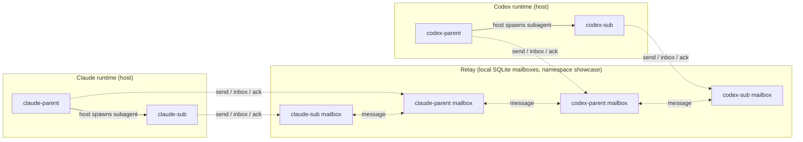
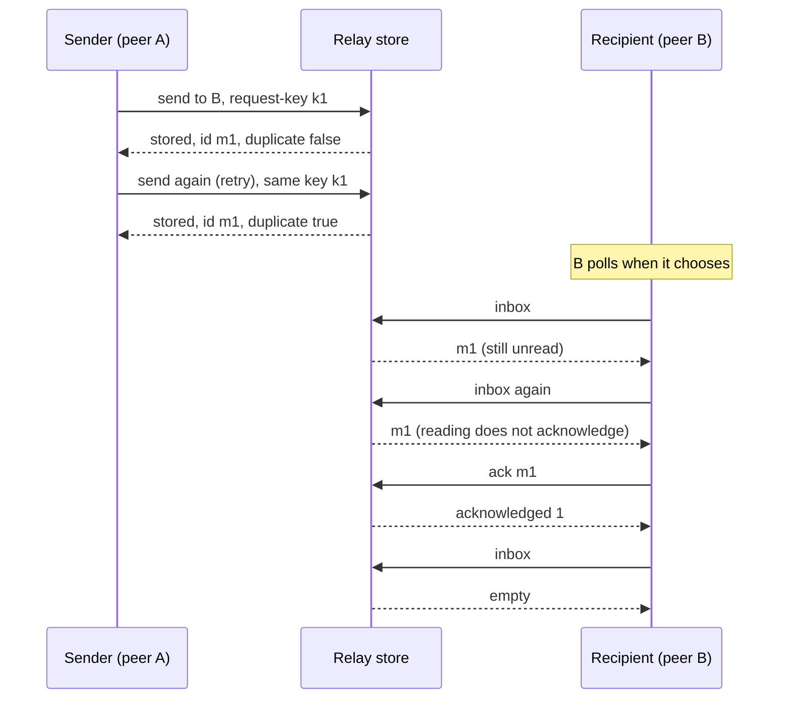
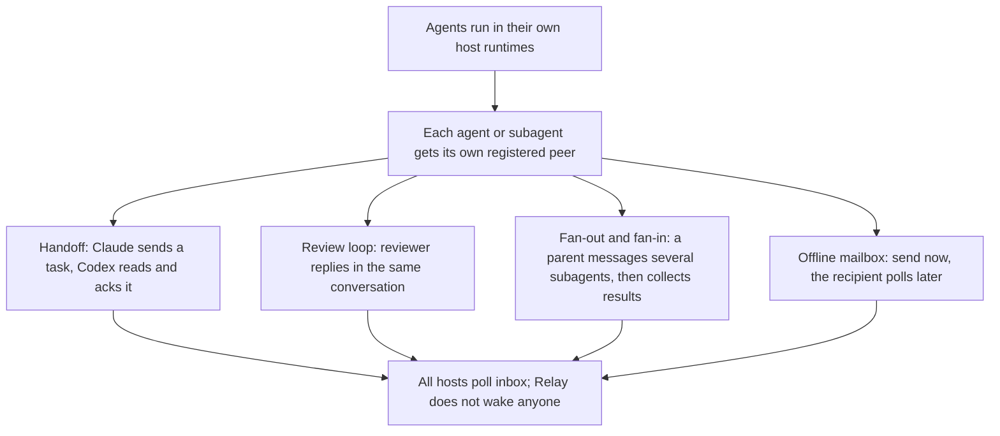

# Relay

Relay lets agents on one machine send each other messages that survive restarts. A Claude session can hand a task to a Codex session, a parent can collect results from its subagents, and nobody has to be online at the same moment. Each agent has its own mailbox and decides when to read it and when to acknowledge what it read.

Relay is the mailbox, nothing more. It does not start agents, create subagents, wake sessions, assign roles or enforce permissions. Your agent runtime (Claude, Codex, T3, ...) creates the agents and subagents; Relay only stores and hands out the messages between peers you registered explicitly. Everything is local: one SQLite file, no hosted service.

Relay 0.2.0 provides durable local mailboxes between explicitly registered peers. CLI and the `peers` MCP server share one SQLite message store. Reading never acknowledges a message; acknowledgement is an explicit operation.

Bun **>= 1.4.2** is the only runtime prerequisite on macOS or Linux. Relay uses Bun's built-in SQLite and has no third-party runtime dependencies. The package remains private; no registry publication is part of this release.

## See it work

Replays of real Relay CLI runs with scripted roles (no AI model; labelled in every frame). Provenance and how to reproduce them: [docs/demos](docs/demos/README.md).

**Cross-agent handoff.** A Claude-host peer sends a task, retries it safely, a Codex-host peer reads it twice, acknowledges it and answers in the same conversation; a third peer sees nothing.


**Parent and subagents across runtimes.** Peers for a Claude parent and subagent and a Codex parent and subagent exchange tasks and results through Relay. The runtimes start the subagents; Relay carries the messages.


## What you can do with it

- **Hand a task across agents.** One agent sends a task, another reads it later, acknowledges it and sends the answer back in the same conversation.
- **Review loops.** A reviewer replies to the author's message; both sides keep a durable record of what was sent and acknowledged.
- **Fan out to subagents and fan in.** A parent agent messages each of its subagents and collects their results, even when the runtimes are different products.
- **Send now, read later.** An offline registered mailbox accepts mail; the owner polls when it comes back.
- **Retry safely.** Send again with the same request key after a crash or a lost reply and you get the original message back, not a duplicate.
- **Keep sessions apart.** Every agent or subagent that takes part needs its own explicit peer binding; one agent cannot read or acknowledge another's mail.

## How it fits together

The runtimes own the agent tree. Relay owns only the mailboxes. Solid arrows below are your host runtime spawning subagents; dotted arrows are Relay messages.



A message is stored first, read any number of times and acknowledged only when the recipient says so. A retry with the same request key returns the original message.



Typical workflows:



The diagram sources are kept as editable files in [docs/diagrams](docs/diagrams).

## Install from a public HTTPS clone

```sh
git clone https://github.com/bbawuah/relay.git
cd relay
./install.sh --prefix "$HOME/.local"
export PATH="$HOME/.local/bin:$PATH"
relay --version
relay doctor
```

Select a checkout containing the 0.2.0 implementation. Installation needs no development dependency installation. It copies an explicit manifest of message-runtime paths and writes a CLI launcher; the checkout may then be moved or deleted. For another prefix, replace both paths above. `./install.sh --prefix /absolute/prefix --dry-run` validates the package and reports the destination without writing it.

Installation never edits shell profiles, provider settings, permissions, hooks or existing message state. Unmanaged targets and paths into the source checkout are refused. Updating a managed installation replaces its runtime copy. `relay uninstall` removes the verified installation from which it runs and preserves state and vendor/project safeguards. Use `--prefix /absolute/prefix` to select a managed installation explicitly when provenance cannot be verified.

## Two manual mailboxes

```sh
one=$(relay register --name one)
two=$(relay register --name two)
relay --peer "$one" send "$two" 'hello from one' --request-key hello-1 --json
relay --peer "$one" send "$two" 'hello from one' --request-key hello-1 --json
relay --peer "$two" inbox --json
relay --peer "$two" inbox --json
```

The retry returns the same message ID with `duplicate: true`. Keys are scoped to the sending peer and namespace, retained for 30 days by default; a changed payload with the same live key is a conflict. A different key permits identical text. `inbox` remains non-destructive. Copy the returned message ID and acknowledge it:

```sh
relay --peer "$two" ack MESSAGE_ID
relay --peer "$two" inbox --json
```

A stored receipt means durable storage, not host notification or task completion. An offline registered mailbox can receive mail. `unregister` marks a peer offline without deleting its inbox. Aliases are case-insensitively unique in a namespace. Reconnecting to another host session uses explicit `rebind` with the expected endpoint generation.

Global options precede the command: `relay --state /absolute/private/state --namespace demo --peer PEER_ID inbox --json`. Default state is `~/.local/state/relay/v2`, default namespace `local`. A legacy state root is refused; see [configuration](docs/configuration.md) and the [migration guide](docs/message-migration.md).

## Explicit MCP binding

Register a mailbox, then configure the host to invoke exactly one fixed peer per connection:

```sh
relay --state /absolute/private/state --namespace demo --peer STABLE_PEER_ID mcp
```

Use the absolute installed `relay` executable as the MCP command, server name **`peers`**, and the arguments shown above. The tools are `send`, `inbox`, `list`, `ack`. MCP requires an explicit stable peer ID on its command line. Tool arguments cannot override the sender, inbox, namespace or peer. Two threads sharing a checkout need separate registered peers and separate MCP bindings. cwd and shared provider environment do not identify a mailbox. Legacy send aliases `naar`, `tekst`, `draad`, `antwoord_op` remain wrapper compatibility fields.

## Polling for every host

All current hosts — **manual, Claude, Codex and T3** — use **polling**. The shipped CLI supplies no notification adapters. A registered host binding does not enable notification delivery. Fetch messages through `inbox` or the bound `peers` MCP server, and acknowledge them explicitly.

`relay serve` runs bounded dispatcher passes (`--once` for one pass), but currently only records notification deferrals because no adapters are configured. It cannot deliver host notifications. Send/read/ack work without notifications and without `serve`; `status --json` exposes the stored deferral diagnoses. No vendor hook installer or agent launcher is supplied.

No safe external T3 notification route has been proven; agent-injected MCP tools are not a background transport, and Relay does not reuse their credentials. Register a T3 mailbox with an explicit `--host t3 --session-id THREAD_ID`, bind its MCP connection explicitly, and poll `inbox`. See the [adapter feasibility report](docs/t3-message-poc.md).

## Migrate an old mailbox store

Stop all old writers first and keep the original state untouched. Select a separate new/empty destination with global `--state`, before `migrate`:

```sh
relay --state /absolute/path/to/new-state --namespace local migrate --source /absolute/path/to/old-state --source-quiesced --held quarantine
```

`--source-quiesced` asserts that you stopped the writers; it cannot prove that they stopped. Held messages default to `quarantine`, outside active inboxes. Use `--held import` or `--held skip` only for an explicit irreversible held-message decision. Inspect the completion report before starting v2 clients. Resume a partial import with the same source, destination and namespace, preserving the destination database, migration ledger and quarantine artifact together. Imported host endpoints become offline manual polling bindings; import never contacts a host. See the [migration guide](docs/message-migration.md) for validation, retention and rollback limits.

## Status and platform limits

Experimental. Atomic database publication uses Bun's experimental FFI; supported are macOS and glibc Linux on x64 and ARM64, while musl and other architectures are refused. The full gate (255 tests, typecheck and package checks) passed on macOS ARM64, and the storage and dispatcher tests passed on Linux ARM64; a full Linux or x64 CI run is not claimed. Native host notification transport is unproven, so every host polls.

## Breaking changes and verification

0.2.0 retires agent launch (`claude`, `codex`), `setup`, policy/role options, `hold`, `release`, `notify-when-idle`, orchestration, Git/merge helpers, tmux management and personal skills. Existing project/harness policy stays outside Relay and is never uninstalled. Do not point old and new writers at one state directory. Before new v2 writes, rollback can return to the untouched old source; after new writes or acknowledgements, preserve/export v2 history and reconcile it explicitly.

For development, `bun install --frozen-lockfile --ignore-scripts` then `bun run poort` runs current message tests, surviving startup/install tests, typecheck and package-boundary checks. Every test uses disposable state; no live provider session is required. Test retirement is documented [per file](docs/test-retirement.md), and historical extraction provenance remains in [source-manifest.json](docs/source-manifest.json). Worker verification and remaining integration gaps are reported in [verification](docs/verification.md).
