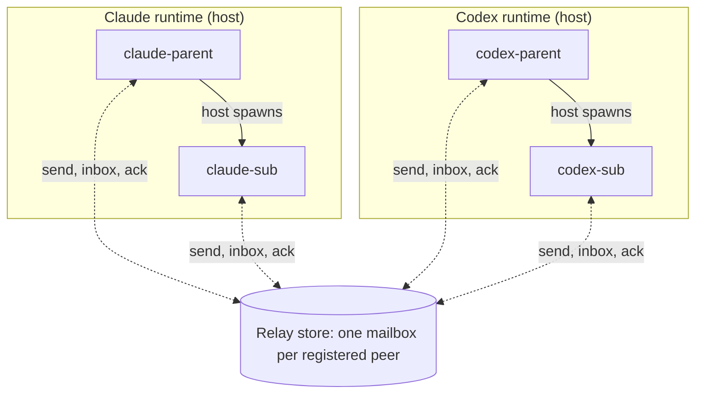
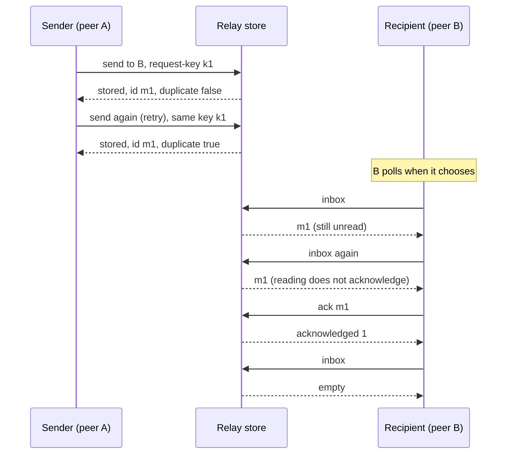
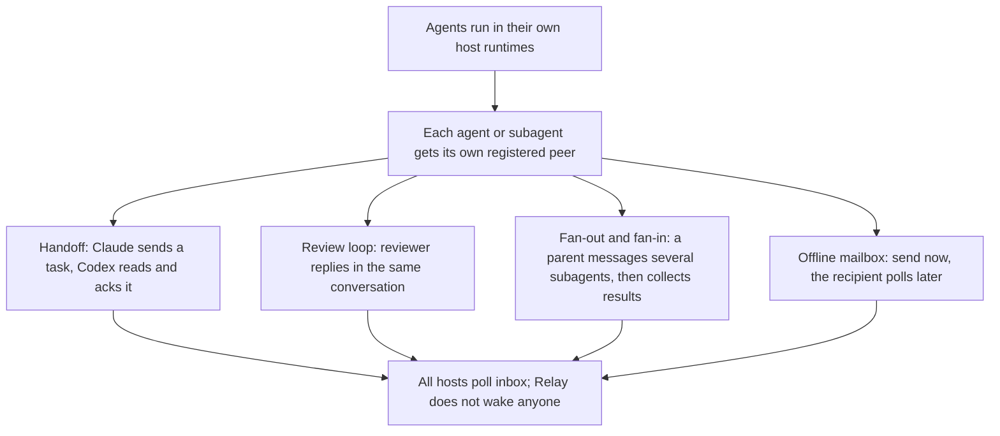

# Relay

Relay lets agents on one machine send each other messages that survive restarts. A Claude session can hand a task to a Codex session, a parent can collect results from its subagents, and nobody has to be online at the same moment. Each agent has its own mailbox and decides when to read it and when to acknowledge what it read. An acknowledgement marks receipt, not task completion.

[Install](#install-from-a-public-https-clone) · [Try two peers](#two-manual-mailboxes) · [Demo](#see-it-work) · [How it works](#how-it-fits-together)

Relay is the mailbox, nothing more. It does not start agents, create subagents, wake sessions, assign roles or enforce permissions. Your agent runtime (Claude, Codex, T3, ...) creates the agents and subagents; Relay only stores and hands out the messages between peers you registered explicitly. Everything is local: one SQLite file, no hosted service.

Relay 0.2.0 provides durable local mailboxes between explicitly registered peers. CLI and the `peers` MCP server share one SQLite message store. Reading never acknowledges a message; acknowledgement is an explicit operation.

Bun **>= 1.4.2** is the only runtime prerequisite on macOS or Linux. Relay uses Bun's built-in SQLite and has no third-party runtime dependencies. The package remains private; no registry publication is part of this release.

## See it work

Four terminal panes in one tmux window: a Claude parent, a Codex parent, a Claude subagent and a Codex subagent. They are the real native `claude` and `codex` command-line tools, started directly in a terminal, with no T3 involved. Every message between them goes through Relay mailboxes; the shell only creates the processes.


[Full-size final frame](docs/media/relay-terminal-four-panes-full.png) · [Text transcript for phones](docs/demos/transcripts/terminal-four-panes.md) · [Sanitised cast](docs/demos/casts/terminal-four-panes.jsonl) · [Provenance and how to reproduce](docs/demos/README.md)

**The story.** The Claude parent asks the Codex parent whether a fixed-size log tail should be a ring buffer or a linked list, and retries the send with the same request key: same message, `duplicate: true`. Each parent hands one small question to its own subagent; the subagent reads its inbox, acknowledges, and replies in the same conversation. The Codex parent reads its inbox twice (reading removes nothing), acknowledges, collects its subagent's answer and sends a review back; a short second Claude session reads and acknowledges it.

**What is real, and what is not.**
- **One real run, replayed.** The GIF is a replay of `tmux capture-pane` output from a single run: 5 native CLI sessions, all exit code 0, 24 Relay calls, all succeeded, about 85 seconds end to end. Waits are shortened, so the GIF (about 44 s) says nothing about speed. It is not a live recording.
- **Non-interactive processes.** The agents run as `claude -p` and `codex exec`. The panes show each process's status plus the activity of the Relay wrapper it called, not an interactive TUI, and nothing here claims typing or a TUI session.
- **Process creation is not Relay.** Magenta `[process]` lines are the shell. A parent starts its own subagent by calling a small helper that only asks the shell to start the child CLI in the fixed pane below it. That is an ordinary shell/tmux child process, not a vendor-internal subagent feature, and Relay did not start or wake anything: every agent polled its own inbox. Two sessions were live at most at any time.
- **Explicit peers, fixed wrappers.** Four manually registered peers in a fresh private namespace. Each agent calls Relay through a wrapper that fixes its own `--peer`, state and namespace and accepts only `send`, `inbox`, `ack`, `list`. This is not an MCP demonstration; MCP scoping is separate product behavior. No hooks, settings, approvals or sandbox were changed or bypassed.
- **Models, from CLI metadata only.** Claude was requested as `--model sonnet`; the CLI reported usage for both `claude-haiku-5-5` and `claude-sonnet-5-5`, and no reason for that is claimed. Codex reported `gpt-6.1-sol` with its native default effort (medium).
- **Wording.** The agents wrote the message texts. An acknowledgement marks receipt, not that work was done. Peer scoping is mailbox scoping, not OS or user authentication.
- **Sanitised.** Peer, message and conversation IDs are aliases (`claude-parent`, `msg-1`, `conv-1`); no home paths, tokens or vendor output are shown. Message bodies longer than 42 characters are cut with `…` in the panes; the transcript has them in full.

<details><summary>Full transcript (sanitised; times relative to the start of the run)</summary>

SHELL lines are process creation, RELAY lines are Relay calls made by the agents.

```text
+  2s SHELL process creation: claude-parent started by shell-runner (not Relay)
+  5s RELAY claude-parent: $ send → codex-parent  key plan-1
         "Design question: for a fixed-size log tai…"
         ✓ stored msg-1 · duplicate false
       body: Design question: for a fixed-size log tail, ring buffer or linked list? Reply with a recommendation after your own helper checks one aspect.
+  8s RELAY claude-parent: $ send → codex-parent  key plan-1
         "Design question: for a fixed-size log tai…"
         ✓ stored msg-1 · duplicate true
       body: Design question: for a fixed-size log tail, ring buffer or linked list? Reply with a recommendation after your own helper checks one aspect.
+ 12s RELAY claude-parent: $ send → claude-sub  key sub-1
         "One sentence: why does a ring buffer suit…"
         ✓ stored msg-2 · duplicate false
       body: One sentence: why does a ring buffer suit a fixed-size log tail?
+ 13s SHELL claude-parent asked the shell to start its own helper process in its pane (not Relay)
+ 13s SHELL process creation: claude-sub started by claude-parent (not Relay)
+ 15s RELAY claude-parent: $ inbox
         (empty, polling again later)
+ 18s RELAY claude-sub: $ inbox
         msg-2 from claude-parent
         "One sentence: why does a ring buffer suit…"
       body: msg-2 from claude-parent: One sentence: why does a ring buffer suit a fixed-size log tail?
+ 21s RELAY claude-sub: $ ack msg-2
         acknowledged: 1
+ 24s RELAY claude-sub: $ send → claude-parent  key sub-1-reply
         reply-to msg-2 in conv-1
         "A ring buffer keeps a fixed-size log tail…"
         ✓ stored msg-3 · duplicate false
       body: A ring buffer keeps a fixed-size log tail because new entries overwrite the oldest in O(1) with no allocation or shifting, so memory stays bounded and the latest N lines are always available.
+ 25s RELAY claude-parent: $ inbox
         msg-3 from claude-sub
         "A ring buffer keeps a fixed-size log tail…"
       body: msg-3 from claude-sub: A ring buffer keeps a fixed-size log tail because new entries overwrite the oldest in O(1) with no allocation or shifting, so memory stays bounded and the latest N lines are always available.
+ 27s SHELL claude-sub process exited, rc 0 · model (CLI metadata): claude-haiku-5-5,claude-sonnet-5-5
+ 30s RELAY claude-parent: $ ack msg-3
         acknowledged: 1
+ 33s SHELL claude-parent process exited, rc 0 · model (CLI metadata): claude-haiku-5-5,claude-sonnet-5-5
+ 33s SHELL process creation: codex-parent started by shell-runner (not Relay)
+ 38s RELAY codex-parent: $ inbox
         msg-1 from claude-parent
         "Design question: for a fixed-size log tai…"
       body: msg-1 from claude-parent: Design question: for a fixed-size log tail, ring buffer or linked list? Reply with a recommendation after your own helper checks one aspect.
+ 40s RELAY codex-parent: $ inbox
         msg-1 from claude-parent
         "Design question: for a fixed-size log tai…"
       body: msg-1 from claude-parent: Design question: for a fixed-size log tail, ring buffer or linked list? Reply with a recommendation after your own helper checks one aspect.
+ 43s RELAY codex-parent: $ ack msg-1
         acknowledged: 1
+ 45s RELAY codex-parent: $ send → codex-sub  key sub-2
         "One sentence: one drawback of a linked li…"
         ✓ stored msg-4 · duplicate false
       body: One sentence: one drawback of a linked list for a fixed-size log tail.
+ 47s SHELL codex-parent asked the shell to start its own helper process in its pane (not Relay)
+ 48s SHELL process creation: codex-sub started by codex-parent (not Relay)
+ 49s RELAY codex-parent: $ inbox
         (empty, polling again later)
+ 52s RELAY codex-sub: $ inbox
         msg-4 from codex-parent
         "One sentence: one drawback of a linked li…"
       body: msg-4 from codex-parent: One sentence: one drawback of a linked list for a fixed-size log tail.
+ 55s RELAY codex-sub: $ ack msg-4
         acknowledged: 1
+ 57s RELAY codex-parent: inbox
+ 59s RELAY codex-sub: $ send → codex-parent  key sub-2-reply
         reply-to msg-4 in conv-3
         "A linked list adds per-entry pointer over…"
         ✓ stored msg-5 · duplicate false
       body: A linked list adds per-entry pointer overhead and has poorer cache locality than a ring buffer for a fixed-size log tail.
+ 63s SHELL codex-sub process exited, rc 0 · model (CLI metadata): gpt-6.1-sol
+ 65s RELAY codex-parent: $ inbox
         msg-5 from codex-sub
         "A linked list adds per-entry pointer over…"
       body: msg-5 from codex-sub: A linked list adds per-entry pointer overhead and has poorer cache locality than a ring buffer for a fixed-size log tail.
+ 67s RELAY codex-parent: $ ack msg-5
         acknowledged: 1
+ 71s RELAY codex-parent: $ send → claude-parent  key final-1
         reply-to msg-1 in conv-2
         "Review: ring buffer recommended. Helper n…"
         ✓ stored msg-6 · duplicate false
       body: Review: ring buffer recommended. Helper note: linked lists add pointer overhead and have poorer cache locality.
+ 75s SHELL codex-parent process exited, rc 0 · model (CLI metadata): gpt-6.1-sol
+ 75s SHELL process creation: claude-parent started by shell-runner (not Relay)
+ 78s RELAY claude-parent: $ inbox
         msg-6 from codex-parent
         "Review: ring buffer recommended. Helper n…"
       body: msg-6 from codex-parent: Review: ring buffer recommended. Helper note: linked lists add pointer overhead and have poorer cache locality.
+ 80s RELAY claude-parent: $ ack msg-6
         acknowledged: 1
+ 81s RELAY claude-parent: $ send → codex-parent  key final-ack-1
         reply-to msg-6 in conv-2
         "Review received: ring buffer it is."
         ✓ stored msg-7 · duplicate false
       body: Review received: ring buffer it is.
+ 85s SHELL claude-parent process exited, rc 0 · model (CLI metadata): claude-haiku-5-5,claude-sonnet-5-5
```

</details>

## What you can do with it

- **Hand a task across agents.** One agent sends a task, another reads it later, acknowledges it and sends the answer back in the same conversation.
- **Review loops.** A reviewer replies to the author's message; both sides keep a durable record of what was sent and acknowledged.
- **Fan out to subagents and fan in.** A parent agent messages each of its subagents and collects their results, even when the runtimes are different products.
- **Send now, read later.** An offline registered mailbox accepts mail; the owner polls when it comes back.
- **Retry safely.** Send again with the same request key after a crash or a lost reply and you get the original message back, not a duplicate, within the request-key retention window (default 30 days).
- **Keep sessions apart.** Every agent or subagent that takes part needs its own explicit peer binding. A fixed MCP connection reads and acknowledges only its bound mailbox; foreign acknowledgements with that binding count zero. This is mailbox scoping, not OS/user authentication: the CLI coordinates agents of one user, and an operator can always choose another peer ID explicitly.

## How it fits together

The runtimes own the agent tree. Relay owns only the mailboxes. Solid arrows below are your host runtime spawning subagents; dotted arrows are the agents using their own Relay mailbox. Messages between agents travel only through Relay.



A message is stored first, read any number of times and acknowledged only when the recipient says so. A retry with the same request key returns the original message.



Typical workflows:



The diagram sources are kept as editable files in [docs/diagrams](docs/diagrams).

## Install from a public HTTPS clone

```sh
git clone https://github.com/bbawuah/relay.git
cd relay
./install.sh --prefix "$HOME/.local"
export PATH="$HOME/.local/bin:$PATH"
relay --version
relay doctor
```

Select a checkout containing the 0.2.0 implementation. Installation needs no development dependency installation. It copies an explicit manifest of message-runtime paths and writes a CLI launcher; the checkout may then be moved or deleted. For another prefix, replace both paths above. `./install.sh --prefix /absolute/prefix --dry-run` validates the package and reports the destination without writing it.

Installation never edits shell profiles, provider settings, permissions, hooks or existing message state. Unmanaged targets and paths into the source checkout are refused. Updating a managed installation replaces its runtime copy. `relay uninstall` removes the verified installation from which it runs and preserves state and vendor/project safeguards. Use `--prefix /absolute/prefix` to select a managed installation explicitly when provenance cannot be verified.

## Two manual mailboxes

```sh
one=$(relay register --name one)
two=$(relay register --name two)
relay --peer "$one" send "$two" 'hello from one' --request-key hello-1 --json
relay --peer "$one" send "$two" 'hello from one' --request-key hello-1 --json
relay --peer "$two" inbox --json
relay --peer "$two" inbox --json
```

The retry returns the same message ID with `duplicate: true`. Keys are scoped to the sending peer and namespace, retained for 30 days by default; a changed payload with the same live key is a conflict. A different key permits identical text. `inbox` remains non-destructive. Copy the returned message ID and acknowledge it:

```sh
relay --peer "$two" ack MESSAGE_ID
relay --peer "$two" inbox --json
```

A stored receipt means durable storage, not host notification or task completion. An offline registered mailbox can receive mail. `unregister` marks a peer offline without deleting its inbox. Aliases are case-insensitively unique in a namespace. Reconnecting to another host session uses explicit `rebind` with the expected endpoint generation.

Global options precede the command: `relay --state /absolute/private/state --namespace demo --peer PEER_ID inbox --json`. Default state is `~/.local/state/relay/v2`, default namespace `local`. A legacy state root is refused; see [configuration](docs/configuration.md) and the [migration guide](docs/message-migration.md).

## Explicit MCP binding

Register a mailbox, then configure the host to invoke exactly one fixed peer per connection:

```sh
relay --state /absolute/private/state --namespace demo --peer STABLE_PEER_ID mcp
```

Use the absolute installed `relay` executable as the MCP command, server name **`peers`**, and the arguments shown above. The tools are `send`, `inbox`, `list`, `ack`. MCP requires an explicit stable peer ID on its command line. Tool arguments cannot override the sender, inbox, namespace or peer. Two threads sharing a checkout need separate registered peers and separate MCP bindings. cwd and shared provider environment do not identify a mailbox. Legacy send aliases `naar`, `tekst`, `draad`, `antwoord_op` remain wrapper compatibility fields.

## Polling for every host

All current hosts — **manual, Claude, Codex and T3** — use **polling**. The shipped CLI supplies no notification adapters. A registered host binding does not enable notification delivery. Fetch messages through `inbox` or the bound `peers` MCP server, and acknowledge them explicitly.

`relay serve` runs bounded dispatcher passes (`--once` for one pass), but currently only records notification deferrals because no adapters are configured. It cannot deliver host notifications. Send/read/ack work without notifications and without `serve`; `status --json` exposes the stored deferral diagnoses. No vendor hook installer or agent launcher is supplied.

No safe external T3 notification route has been proven; agent-injected MCP tools are not a background transport, and Relay does not reuse their credentials. Register a T3 mailbox with an explicit `--host t3 --session-id THREAD_ID`, bind its MCP connection explicitly, and poll `inbox`. See the [adapter feasibility report](docs/t3-message-poc.md).

## Migrate an old mailbox store

Stop all old writers first and keep the original state untouched. Select a separate new/empty destination with global `--state`, before `migrate`:

```sh
relay --state /absolute/path/to/new-state --namespace local migrate --source /absolute/path/to/old-state --source-quiesced --held quarantine
```

`--source-quiesced` asserts that you stopped the writers; it cannot prove that they stopped. Held messages default to `quarantine`, outside active inboxes. Use `--held import` or `--held skip` only for an explicit irreversible held-message decision. Inspect the completion report before starting v2 clients. Resume a partial import with the same source, destination and namespace, preserving the destination database, migration ledger and quarantine artifact together. Imported host endpoints become offline manual polling bindings; import never contacts a host. See the [migration guide](docs/message-migration.md) for validation, retention and rollback limits.

## Status and platform limits

Experimental. Atomic database publication uses Bun's experimental FFI; supported are macOS and glibc Linux on x64 and ARM64, while musl and other architectures are refused. The full gate (255 tests, typecheck and package checks) passed on macOS ARM64, and 124 store, dispatcher, migration, CLI and MCP tests passed on Linux ARM64 for the final candidate; a full Linux or x64 CI run is not claimed. Native host notification transport is unproven, so every host polls.

## Breaking changes and verification

0.2.0 retires agent launch (`claude`, `codex`), `setup`, policy/role options, `hold`, `release`, `notify-when-idle`, orchestration, Git/merge helpers, tmux management and personal skills. Existing project/harness policy stays outside Relay and is never uninstalled. Do not point old and new writers at one state directory. Before new v2 writes, rollback can return to the untouched old source; after new writes or acknowledgements, preserve/export v2 history and reconcile it explicitly.

For development, `bun install --frozen-lockfile --ignore-scripts` then `bun run poort` runs current message tests, surviving startup/install tests, typecheck and package-boundary checks. Every test uses disposable state; no live provider session is required. Test retirement is documented [per file](docs/test-retirement.md), and historical extraction provenance remains in [source-manifest.json](docs/source-manifest.json). Worker verification and remaining integration gaps are reported in [verification](docs/verification.md).
