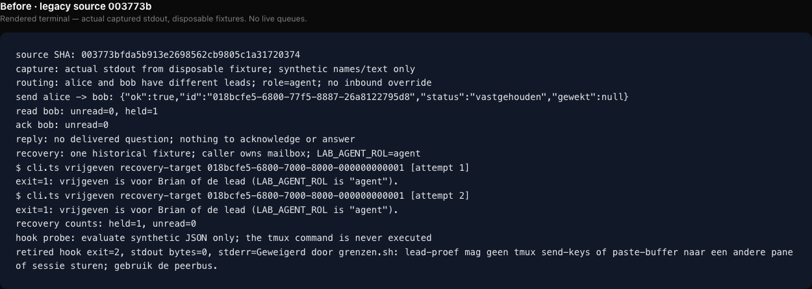
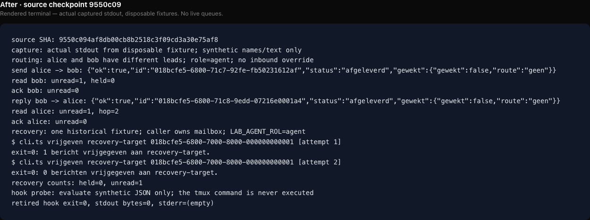

# Bewijs uit wegwerpfixtures

De PNG's zijn **gerenderde terminalweergaven van werkelijk vastgelegde stdout**. Het zijn geen screenshots van een echte agentsessie, geen verzonnen UI en geen CI-dashboard. De ruwe tekstbestanden zijn de bron voor de weergave; alleen kop, lettertype en regelomloop zijn toegevoegd.

Alle namen, teksten, identities en queues zijn synthetisch en tijdelijk. Geen live 17-peerwachtrij, credentials, privésessie of globale hook is gelezen of bediend. De hookproef evalueert uitsluitend JSON: het commando in `tool_input` wordt nooit uitgevoerd.

## Reproduceren

Voer vanuit de repository de evidence-runner uit met een volledige bron-SHA:

```sh
bun docs/policy-reset/evidence/run.ts 003773bfda5b913e2698562cb9805c1a31720374
bun docs/policy-reset/evidence/run.ts 9550c094af8db00cb8b2518c3f09cd3a30e75af8
```

De runner maakt een tijdelijk Git-archief van exact die bron, registreert niet-gerelateerde peers zonder inboundoverride, gebruikt een bus zonder native wekker, demonstreert read/ack/reply en expliciet heldherstel als `agent`, en verwijdert de tijdelijke map in `finally`. De exacte SHA staat bovenaan iedere capture. Het na-bewijs wordt na het codecheckpoint als afzonderlijke bewijscommit toegevoegd, zodat de bron-SHA en reviewscope vaststaan.

## Captures

- [Vóór: werkelijke uitvoer](before.txt) en [terminalbeeld](before.png): bron `003773bfda5b913e2698562cb9805c1a31720374`; niet-gerelateerde send wordt vastgehouden, herstel door `agent` geweigerd, oude rolguard weigert de synthetische hookproef.
- [Na: werkelijke uitvoer](after.txt) en [terminalbeeld](after.png): exacte codecheckpoint-SHA in de capture; afgeleverd, gelezen, geackt en beantwoord, herstel door `agent` één keer, herhaling nul en shim exit 0.





De geparameteriseerde test in `scripts/lead/peers/policy-retirement.test.ts` controleert dezelfde aflevering voor 17 niet-gerelateerde peers. De terminalcapture gebruikt twee peers om de verandering leesbaar te tonen. Native approvalbehoud, locks, rate-/groottegrenzen, corrupte records en upgrade-idempotentie worden met gerichte tests onderbouwd; een screenshot voegt daar geen betrouwbaar bewijs aan toe. De volledige `bun run poort` blijft de codecontrole.

De captures testen geen live activering en lossen de bekende MCP-cachegrens van issue 718 niet op. Voor installatie en expliciet live herstel geldt het afzonderlijke [activeringsplan](../ACTIVERING.md).

Definitieve bronfreeze: `9550c094af8db00cb8b2518c3f09cd3a30e75af8`. De afzonderlijke artefactcommit bevat alleen documentatie/captures; de tweede review en volledige poort hebben deze runtimebron gecontroleerd. Zie [reviewboekhouding](../REVIEW.md) en [capturechecksums](manifest.json).
